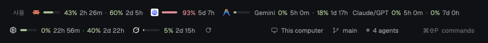

# token-gage

Herdr 하단 상태바 왼쪽에 Claude, Codex, Antigravity, Devin, Grok의 토큰 사용률과 리셋까지 남은 시간을 한 줄로 보여 주는 mod입니다. 서비스마다 아이콘, 작은 사용률 막대, `38% 3h 13m · 59% 2d 6h` 같은 창별 수치가 이어지고, 맨 끝 ⟳를 누르면 바로 다시 불러옵니다. 오른쪽에는 Herdr 기본 상태 정보(`workspace-status`)가 그대로 남습니다.



> 이 mod는 네트워크에 접속하고(`fetch`), 프로그램을 실행하며(`security`, `agy`), 자기 폴더 밖의 자격 증명 파일(`~/.codex/auth.json`, `~/.grok/auth.json`, `~/.local/share/devin/credentials.toml`)과 macOS 키체인을 읽습니다. 자세한 내용은 아래 Built from과 Watch out에 있습니다.

## What you see

창 맨 아래 높이 28px 한 줄입니다. 왼쪽 블록(weight 1)이 token-gage, 오른쪽 블록(400px)이 기본 `workspace-status`입니다. token-gage는 theme `chrome` 바탕, 위쪽 1px theme `border` 선, 좌우 패딩 14px, 글자 11.8px로 그려서 오른쪽 블록과 이어져 보입니다.

왼쪽부터 다음 순서로 놓이고, 칸 사이는 14px입니다.

1. `사용` 라벨 (theme `dim`)
2. 서비스 칸 5개, 순서는 Claude → Codex → Antigravity → Devin → Grok으로 고정
   - **아이콘 14px:** Claude, Codex, Antigravity는 Herdr 내장 `icons/claude.svg`, `icons/codex.svg`, `icons/antigravity.svg`를 원래 색으로 씁니다. Grok은 내장 `icons/grok.svg`, Devin은 mod의 `devin.svg`(육각형 안에 D)이고, 둘 다 theme `foreground`로 칠합니다.
   - **사용률 막대 30×4px**, 모서리 2px. 바탕은 theme `border`이고, 칸에서 가장 높은 사용률만큼 채웁니다(0보다 크면 최소 2px).
   - **창별 수치:** 퍼센트(단계 색) 뒤에 리셋까지 남은 시간(theme `muted`)이 붙고, 창 사이에는 `·`(theme `dim`)이 들어갑니다. 남은 시간 형식은 1분 미만 `곧`, 1시간 미만 `35m`, 하루 미만 `4h 10m`, 하루 이상 `2d 7h`입니다.
   - **서비스별 창:**
     - Claude: `5h` · `주간`
     - Codex: `5h`(계정에 있을 때) · `주간`
     - Antigravity: 그룹 이름 `Gemini`, `Claude/GPT`(theme `muted`) 뒤에 각각 `5h` · `주간`
     - Devin: `일간` · `주간`
     - Grok: `주간`(또는 `월간`) 하나
3. ⟳ 새로고침 버튼: 아이콘 12px(theme `muted`), 패딩 3px, 모서리 4px

단계 색은 막대 채움과 퍼센트 글자에 똑같이 씁니다. 70% 미만은 `ansi2`(초록), 70~89%는 `ansi3`(노랑), 90% 이상은 `ansi1`(빨강)입니다.

## How it behaves

에이전트 상태(working, blocked, done, idle)는 쓰지 않습니다. 대신 서비스 칸마다 다음 상태 중 하나를 보입니다.

- **불러오는 중:** 아이콘 + `…`(theme `dim`)
- **정상:** 막대 + 창별 수치
- **정상이지만 마지막 조회 실패:** 직전 수치를 그대로 두고 끝에 경고 삼각형(12px, `ansi3`)을 붙입니다.
- **로그인·실행 필요:** 경고 삼각형 + 안내 문구(theme `muted`, 넘치면 말줄임). 문구는 다음과 같습니다.
  - `Claude Code를 실행하세요`, `Claude Code 로그인이 필요합니다`
  - `Codex를 실행하세요`, `Codex 로그인이 필요합니다`
  - `agy로 Antigravity에 로그인하세요`
  - `devin auth login으로 다시 로그인하세요`, `Devin 로그인이 필요합니다`
  - `Grok을 실행하세요`, `grok login으로 로그인하세요`
- **오류(직전 값 없음):** 경고 삼각형 + `새로 고침 실패`

**툴팁:** 서비스 칸에 마우스를 0.5초 올리면 여러 줄 툴팁이 뜹니다.
- 첫 줄은 서비스 이름이고, 다음 줄부터 `5h: 31% 사용 · 3h 20m 후 리셋` 형식으로 창마다 한 줄씩 나옵니다. Antigravity는 `Gemini 5h: …`처럼 앞에 그룹 이름이 붙습니다.
- 마지막 조회가 실패했으면 맨 끝에 `⚠ 마지막 조회 실패: <원인>`이 붙습니다.
- 로그인·오류 칸은 `<서비스>: <안내>` 한 줄입니다.

**⟳ 버튼:**
- 클릭하면 조회 중이 아닌 모든 서비스를 바로 다시 조회합니다.
- 조회가 하나라도 진행 중이면 900ms에 한 바퀴씩 돕니다.
- 마우스를 올리면 theme `hover` 바탕이 깔리고 툴팁 `지금 새로 고침`이 뜹니다.

**자동 갱신:**
- 30초마다 다시 그려 남은 시간을 줄이고, 조회 주기가 지난 서비스만 다시 조회합니다.
- 조회 주기는 Claude·Codex·Devin·Grok이 2분, Antigravity가 5분입니다.
- 조회에 실패해도 주기보다 자주 부르지 않습니다.

**좁은 폭:** 블록 폭이 820px보다 좁으면 남은 시간과 안내 문구를 숨기고, 아이콘·막대·퍼센트만 남깁니다.

키 바인딩은 없습니다.

## Built from

**레이아웃.** 기본 `main`을 복제한 레이아웃에서 하단 `status` 블록(28px, `workspace-status`)을 아래 row로 바꿉니다. props는 없고, 기본 mod `workspace-status`는 손대지 않고 그대로 씁니다.

```json
{ "id": "status-row", "type": "row", "size": { "px": 28 }, "resizable": false,
  "children": [
    { "id": "token-gage", "type": "block", "size": { "weight": 1 }, "content": { "mod": "token-gage" } },
    { "id": "status", "type": "block", "size": { "px": 400 }, "content": { "mod": "workspace-status" } } ] }
```

**mod `mods/token-gage/`.** `mod.json`은 `{ "place": "none", "title": "token-gage" }`입니다.

- `main.js`: View 하나입니다.
  - 서비스별 결과를 객체로 들고 있으며, 바꿀 때마다 새 객체로 교체합니다.
  - `cx.timer.every(30000)`로 화면을 다시 그리고 조회할 서비스를 고르며, 서비스마다 `cx.spawn`으로 조회합니다.
  - `on_size_change`로 좁은 폭 모드를 정합니다.
- `view.js`: 칸, 막대, 툴팁, 경고 아이콘을 그립니다.
- `provider-claude.js`, `provider-codex.js`, `provider-antigravity.js`, `provider-devin.js`, `provider-grok.js`: 서비스마다 하나씩 있습니다.
  - `herdr`를 import하지 않고 `{ exec, readTextFile, home, fetch, now }`를 넘겨받으므로, node 단위 테스트에서 가짜를 넣을 수 있습니다.
  - 결과는 `{ id, status: "ok" | "error" | "login", windows: [{ label, usedPercent, resetsAt, group }], message, updatedAt }`입니다.
- `format.js`(남은 시간·퍼센트·단계), `model.js`(결과 형태·시각 해석), `summary.js`(툴팁·그룹 묶기), `scheduler.js`(조회 시점·실패 시 직전 값 유지), `providers.js`(서비스 목록·주기): 모두 순수 함수입니다.
- 쓰는 `herdr` 함수는 `exec`, `readTextFile`, `home`, `theme`이고, 전역 `fetch`도 씁니다. 앱 명령(`run`)은 쓰지 않습니다.
- 그림: `devin.svg`, `alert.svg`, `refresh.svg`. 24×24 viewBox, stroke 2의 선 아이콘이고 `svg()`로 칠합니다.

**실행하는 프로그램**

- `security find-generic-password -s "Claude Code-credentials" -w`
- `/usr/bin/env AGY_CLI_DISABLE_AUTO_UPDATE=true ~/.local/bin/agy --version`
- `/usr/bin/env AGY_CLI_DISABLE_AUTO_UPDATE=true ~/.local/bin/agy -p /usage --output-format json --print-timeout 20s`

**데이터 소스**

| 서비스 | 자격 증명 | 요청 | 응답 → 창 |
|---|---|---|---|
| Claude | 키체인 `Claude Code-credentials`의 `claudeAiOauth.accessToken`, `expiresAt` | GET `https://api.anthropic.com/api/oauth/usage`, 헤더 `Authorization: Bearer …`, `anthropic-beta: oauth-2025-04-20` | `five_hour` → `5h`, `seven_day` → `주간`. 사용률은 `utilization`(0~100), 리셋은 `resets_at`(ISO) |
| Codex | `~/.codex/auth.json`의 `tokens.access_token`, `tokens.account_id` | GET `https://chatgpt.com/backend-api/wham/usage`, 헤더 `Authorization`, `ChatGPT-Account-Id` | `rate_limit.primary_window` / `secondary_window`의 `used_percent`. 창 길이는 `limit_window_seconds`(18000 → `5h`, 604800 → `주간`), 리셋은 `reset_at`(유닉스 초), 없으면 `reset_after_seconds`. 짧은 창이 먼저 |
| Antigravity | agy CLI 로그인 | 위 agy 명령 | `status: "SUCCESS"`이고 `command.name: "usage"`인 JSON 줄의 `command.data.groups[].buckets[]`. 사용률 = (1 − `remaining_fraction`) × 100, `window`는 `5h` / `weekly`, 리셋은 `reset_time`. 그룹 이름은 끝의 "Models"를 빼고 " and "를 "/"로 바꿈 |
| Devin | `~/.local/share/devin/credentials.toml`의 `windsurf_api_key`, `api_server_url` | POST `{api_server_url}/exa.seat_management_pb.SeatManagementService/GetUserStatus`, 헤더 `Content-Type: application/json`, `Connect-Protocol-Version: 1`, 본문 `{"metadata":{"apiKey","ideName":"devin-cli","ideVersion","extensionVersion"}}` | `userStatus.planStatus`에서 사용률 = 100 − `dailyQuotaRemainingPercent` / `weeklyQuotaRemainingPercent`, 리셋은 `dailyQuotaResetAtUnix` / `weeklyQuotaResetAtUnix`. `planInfo.hideDailyQuota` / `hideWeeklyQuota`면 해당 창 생략 |
| Grok | `~/.grok/auth.json`에서 키가 `https://auth.x.ai`로 시작하는 항목의 `key`, `user_id`, `expires_at` | GET `https://cli-chat-proxy.grok.com/v1/billing?format=credits`, 헤더 `Authorization`, `X-XAI-Token-Auth: xai-grok-cli`, `x-userid` | `config.creditUsagePercent` + `currentPeriod.end`(유형이 `USAGE_PERIOD_TYPE_WEEKLY`면 `주간`, 아니면 `기간`). 없으면 `monthlyLimit.val`과 `used.val`로 계산해 `월간` |

HTTP 401·403은 로그인·실행 필요 상태로, 그 밖의 2xx가 아닌 응답은 `<서비스> 요청 실패 (HTTP <코드>)` 오류로 처리합니다.

## Watch out

- **비공식 API입니다.** 공개 문서가 없는 엔드포인트를 쓰므로 서비스 쪽이 바뀌면 깨질 수 있습니다. 깨지면 해당 칸에 경고 삼각형이나 `새로 고침 실패`가 뜹니다.
- **토큰을 갱신하지 않습니다.** 갱신하면 refresh token이 바뀌어 각 CLI의 로그인이 풀릴 수 있기 때문입니다. 대신 만료된 토큰이면 네트워크 요청 없이 바로 안내를 띄웁니다. Claude는 `expiresAt`이 지났을 때, Grok은 `expires_at`이 60초 안으로 다가왔을 때입니다.
  - Grok 토큰은 약 6시간짜리라 `Grok을 실행하세요`가 자주 보입니다. `grok`을 한 번 실행하면 다음 조회부터 다시 표시됩니다.
- **agy는 1.1.11 이상이어야 합니다.** 그보다 낮은 버전은 `/usage`를 프롬프트로 처리해 할당량을 씁니다. 그래서 먼저 `--version`을 확인하고, 낮으면 `/usage`를 부르지 않습니다.
  - `AGY_CLI_DISABLE_AUTO_UPDATE=true`를 꼭 넘깁니다.
  - Herdr `exec`에는 env 옵션이 없어서 `/usr/bin/env`로 감쌉니다.
  - agy 경로는 `~/.local/bin/agy`로 고정되어 있습니다.
- **Claude는 macOS 전용입니다.** 키체인을 `security`로 읽기 때문입니다. 처음 실행할 때 키체인 접근 허용 창이 뜰 수 있습니다.
- **토큰은 메모리에서만 씁니다.** 로그, 파일, `shared` 상태에 남기지 않고, 오류 문구에도 넣지 않습니다.
- **조회 부하를 늘리지 않습니다.** 429(요청 과다)가 와도 주기를 지키고, 화면 다시 그리기는 30초에 한 번입니다. 애니메이션은 `spin()`만 씁니다.
- Devin 요청의 `ideVersion` / `extensionVersion`은 `3000.11.234`로 고정되어 있습니다.
- **화면 글자는 한국어입니다:** `사용`, `주간`, `일간`, `월간`, `기간`, `곧`, `새로 고침 실패`.
- **레이아웃은 복제한 것에서만 고칩니다.** 기본 레이아웃은 읽기 전용이라 먼저 `herdr-app do layout.clone '{"name":"main","as":"<이름>"}'`로 복제한 뒤 `status` 블록을 바꿉니다.
  - `workspace-status` 400px에는 기계 이름, 브랜치, 에이전트 수, 팔레트 단축키가 들어갑니다.
  - 서비스 5개를 모두 펼치면 약 1250px가 필요하고, 820px 미만이면 좁은 폭 모드가 됩니다.

## Done when

- `herdr-app check ~/.config/herdr-app/mods/token-gage`가 통과하고, `herdr-app status`의 `errors`가 `[]`입니다.
- 불러온 뒤 10초 안에 로그인된 서비스마다 아이콘, 막대, `31% 3h 20m · 59% 2d 6h` 형식의 수치가 보입니다. Antigravity는 `Gemini …  Claude/GPT …` 두 그룹으로 나옵니다.
- 사용률이 90% 이상인 창은 막대와 퍼센트가 `ansi1`(빨강)입니다.
- Grok 토큰이 만료됐으면 네트워크 요청 없이 `Grok을 실행하세요`가 뜹니다. `grok`을 한 번 실행하고 2분 안에(또는 ⟳를 누르면) `N% Xd Yh`로 바뀝니다.
- agy가 1.1.11 미만이면 `새로 고침 실패`가 뜨고, `/usage`는 실행되지 않습니다.
- ⟳를 누르면 조회하는 동안 아이콘이 돌고, 끝나면 수치가 갱신됩니다.
- 서비스 칸에 마우스를 올리면 창별 사용률과 리셋까지 남은 시간이 담긴 여러 줄 툴팁이 뜹니다.
- 블록 폭이 820px보다 좁으면 남은 시간과 안내 문구가 사라집니다.
- 이 저장소에서 `npm test`를 실행하면 79개 테스트가 모두 통과합니다.
